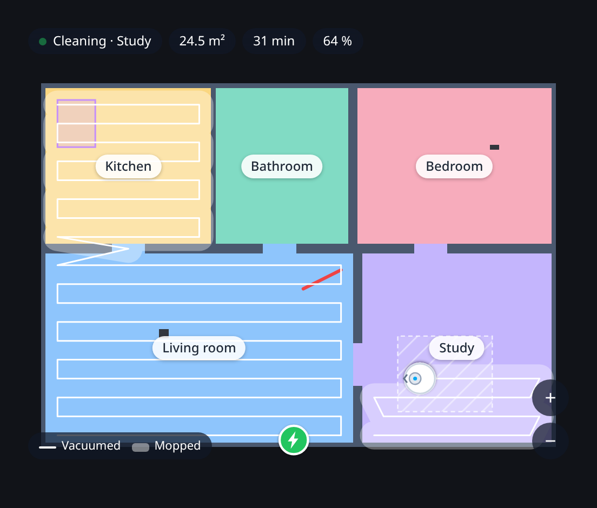
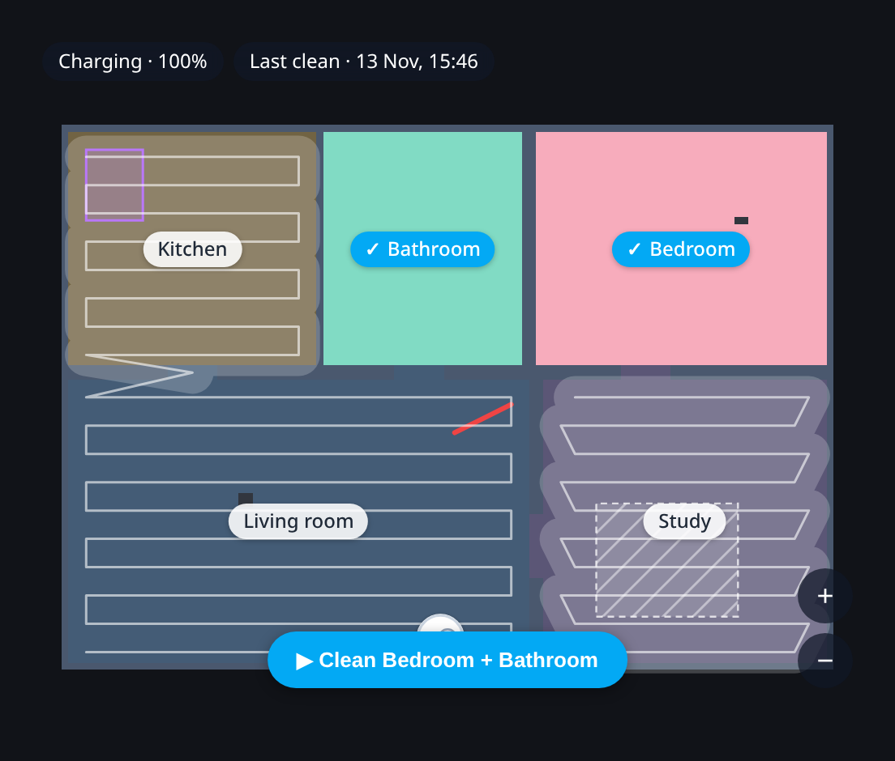

# Xiaomi Live Map for Home Assistant

[](https://hacs.xyz/docs/faq/custom_repositories)
[](https://github.com/ArnavVarshney/ha-xiaomi-live-map/actions/workflows/validate.yml)
[](https://github.com/ArnavVarshney/ha-xiaomi-live-map/actions/workflows/tests.yml)

A Mi Home–style live map for Xiaomi robot vacuums: rooms, the robot moving in near real time, and the vacuum and mop
paths drawn as it cleans. Tap rooms on the map and start a clean from the card.

| While cleaning | Docked: last clean and room picking |
| --- | --- |
|  |  |

<sub>Screenshots use the made-up apartment from the test suite.</sub>

## Features

- **Live position and path.** While the robot cleans, its live map file is read every few seconds (3 s by default
  while a card is open). Only the new path points go to the browser, and the robot glides along them between updates.
- **Vacuum and mop shown separately:** a thin line where it vacuumed and a wide translucent band where it mopped.
- **Rooms** in Mi Home colours with name labels, plus carpets, virtual walls, no-go and no-mop zones, and the dock.
- **Last clean.** When the robot docks, the finished path stays on the map with its time, even across restarts.
- **Pick rooms and clean.** Tap rooms to select them, then tap **▶ Clean** twice. The card runs your script with the
  selected room ids.
- Zoom buttons, pinch, drag, ctrl/⌘ + scroll, and double-click to reset. The card fits any column width, desktop or
  phone.
- Status chips: any entities you like (status, area, time, battery).
- Polls slowly when nobody is looking and the robot is docked (every 5 minutes), and quickly the moment a clean starts.

## How it works

Xiaomi robots upload an encrypted map file to the Xiaomi cloud every few seconds while they clean. The map, robot
position, path and per-point vacuum/mop mode are all in that file.

[Xiaomi Cloud Map Extractor](https://github.com/PiotrMachowski/Home-Assistant-custom-components-Xiaomi-Cloud-Map-Extractor)
already logs in to the Xiaomi cloud and finds your robot. This integration reuses that session to download the live
map file on its own schedule. It decrypts the file and streams a compact version to the card over Home Assistant's
websocket API. It needs no extra credentials and creates no entities. The card is served by the integration, so there
is no dashboard resource to add.

## Requirements

- Home Assistant 2025.2 or newer.
- [Xiaomi Cloud Map Extractor](https://github.com/PiotrMachowski/Home-Assistant-custom-components-Xiaomi-Cloud-Map-Extractor)
  **v3** (tested with v3.0.0-alpha-24), set up for your robot.
- A Xiaomi-platform robot, with a model id starting with `xiaomi.vacuum.`.

### Tested robots

| Model | Name | Status |
| --- | --- | --- |
| `xiaomi.vacuum.qv12cn` | Xiaomi Robot Vacuum 7 Max | Live map, paths and mop band verified |

Other `xiaomi.vacuum.*` robots that upload the same JSON grid map should work. If yours doesn't, the card shows
*"not in the JSON grid format"* or a decrypt error. Please open an issue and attach the integration's diagnostics:
they contain the map file's field names and point counts, but no coordinates or room names. Roborock, Dreame, Viomi
and Roidmi robots use different formats and are not supported.

## Installation

### HACS (recommended)

1. In HACS, open the menu ⋮ → **Custom repositories**.
2. Add `https://github.com/ArnavVarshney/ha-xiaomi-live-map` with type **Integration**.
3. Install **Xiaomi Live Map** and restart Home Assistant.

### Manual

Copy `custom_components/xiaomi_live_map` into your `config/custom_components/` folder and restart.

## Setup

1. **Settings → Devices & services → Add integration → Xiaomi Live Map.**
2. Pick your robot (its Xiaomi Cloud Map Extractor entry). These optional entities are recommended:
   - **Vacuum entity**: makes the map switch to fast updates the moment a clean starts.
   - **Job active entity**: an on/off entity that stays on for the whole job, including mop-washing trips to the dock.
     Without it, those trips look like the end of the clean and the map slows down. The map still keeps updating
     quickly for 2 minutes after the robot stops.
   - **Map name entity**: only needed if your robot's live map object is not named `0`. Use a sensor whose state
     looks like `{"obj_name": "<user>/<device>/<name>"}`, such as the map object name sensor that Xiaomi Home creates for some robots.
3. Add the card to a dashboard. It is listed as **Xiaomi Live Map** in the card picker, or use YAML:

```yaml
type: custom:xiaomi-live-map-card
status_entity: sensor.robot_status            # optional, first chip
chips:                                        # optional, shown while cleaning
  - sensor.robot_cleaning_area
  - sensor.robot_cleaning_time
  - sensor.robot_battery_level
start_script: script.clean_rooms              # optional, enables the ▶ Clean button
grid_options:
  columns: 12
```

### Card options

| Option | Default | Description |
| --- | --- | --- |
| `status_entity` | none | Entity whose state is shown in the first chip, with a pulsing dot while cleaning. |
| `chips` | `[]` | Entities shown as chips while a clean is running. |
| `start_script` | none | Script started by **▶ Clean**, with the variables `rooms` (list of room ids) and `room_names`. |
| `rooms` | none | Map of room id to an `input_boolean`, if you keep the room selection in helpers. Tapping a room toggles its helper. Without it, the selection lives in the card. |
| `mop_modes` | `[2, 3]` | `sweep_mop_mode` values drawn as mopped. On the qv12cn, 1 is vacuum only and 3 is vacuum and mop. |
| `mop_width` | `300` | Width of the mop band, in millimetres. |
| `max_height` | `720` | Maximum card height in pixels. |
| `entry_id` | none | Which robot to show, needed only when several robots are set up. |

### Example: a room-clean script

The card passes the selected room ids. How a room clean is started depends on the robot. With the
[Xiaomi Home](https://github.com/XiaoMi/ha_xiaomi_home) integration, the qv12cn exposes a *start vacuum room sweep*
notify entity that takes comma-separated room ids:

```yaml
script:
  clean_rooms:
    alias: Clean rooms
    fields:
      rooms:
        description: Room ids, e.g. [3, 8]
        required: true
    sequence:
      - action: notify.send_message
        target:
          entity_id: notify.xiaomi_cn_123456789_qv12cn_start_vacuum_room_sweep_a_2_16
        data:
          message: "{{ rooms | join(',') }}"
```

The card passes the room ids from the map file, which are the robot's own segment ids. On the qv12cn the robot accepts
them (its cleaning config then lists the same room), but check that a room clean goes where you expect on your robot.

> **Tip:** on the qv12cn, a paused job is resumed and a new room list is ignored. Stop the robot before starting a
> room clean.

### Integration options

**Settings → Devices & services → Xiaomi Live Map → Configure** changes the entities and the update intervals:

| Option | Default |
| --- | --- |
| While cleaning, card open | 3 s |
| While cleaning, no card open | 10 s |
| While docked, no card open | 300 s |

While docked with a card open, the map is checked every 30 s. Each check is one small download from the Xiaomi cloud,
and an unchanged file is not processed again.

## Troubleshooting

The card shows problems as an orange chip:

| Message | Fix |
| --- | --- |
| *Xiaomi Cloud Map Extractor is not loaded* | Check that integration's entry. It must be loaded and logged in. |
| *Xiaomi cloud session expired* | Reconfigure Xiaomi Cloud Map Extractor and log in again. |
| *This version of Xiaomi Cloud Map Extractor is not supported* | Install the v3 line of the extractor. |
| *The Xiaomi cloud did not answer in time* | Usually temporary. The map catches up on the next update. |
| *Could not decrypt the map file* or *not in the JSON grid format* | Your model is not supported yet. Please open an issue with diagnostics. |

When the robot is still locating itself at the start of a clean, its reported position can jump around for a minute.
The path starts once it begins cleaning.

Debug logging:

```yaml
logger:
  logs:
    custom_components.xiaomi_live_map: debug
```

## Development

```bash
uv venv && uv pip install -r requirements_test.txt
pytest
ruff check . && ruff format --check .

# Card playground with a fake Home Assistant and the synthetic apartment:
python dev/make_payload.py
xdg-open "dev/demo.html?m=live"   # or ?m=last
```

## Credits

- [Xiaomi Cloud Map Extractor](https://github.com/PiotrMachowski/Home-Assistant-custom-components-Xiaomi-Cloud-Map-Extractor)
  by Piotr Machowski for the Xiaomi cloud login and map download.
- [vacuum-map-parser-xiaomi](https://pypi.org/project/vacuum-map-parser-xiaomi/) for the map decryption.

This project is not affiliated with Xiaomi.

## License

[MIT](LICENSE)
